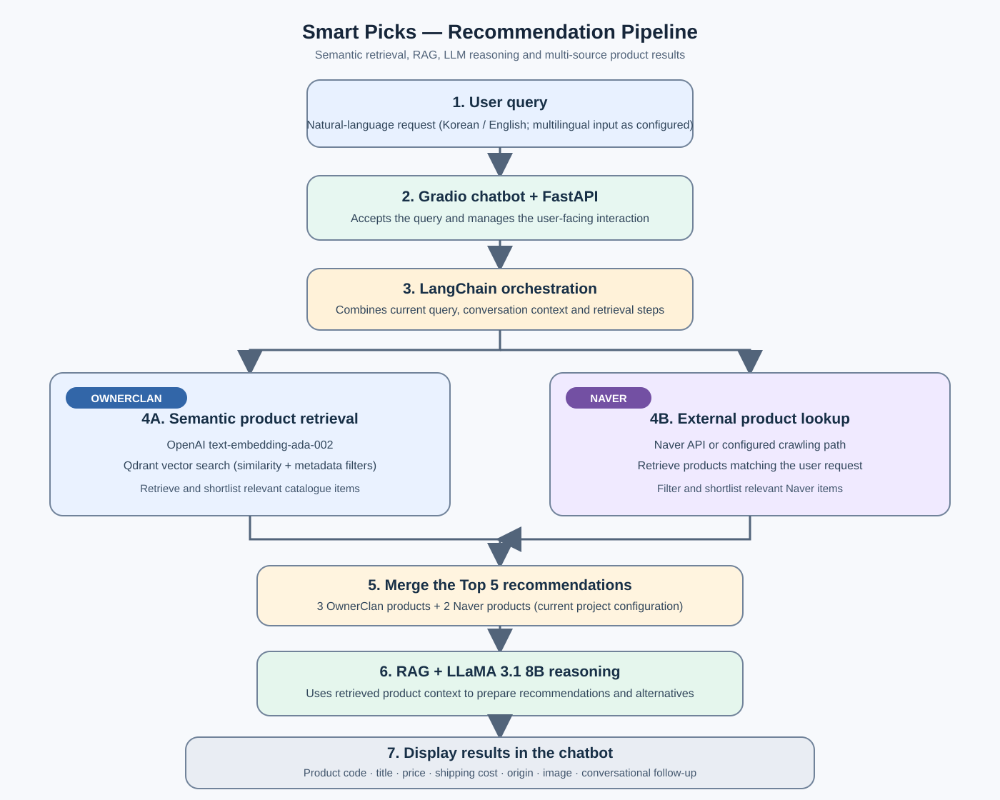
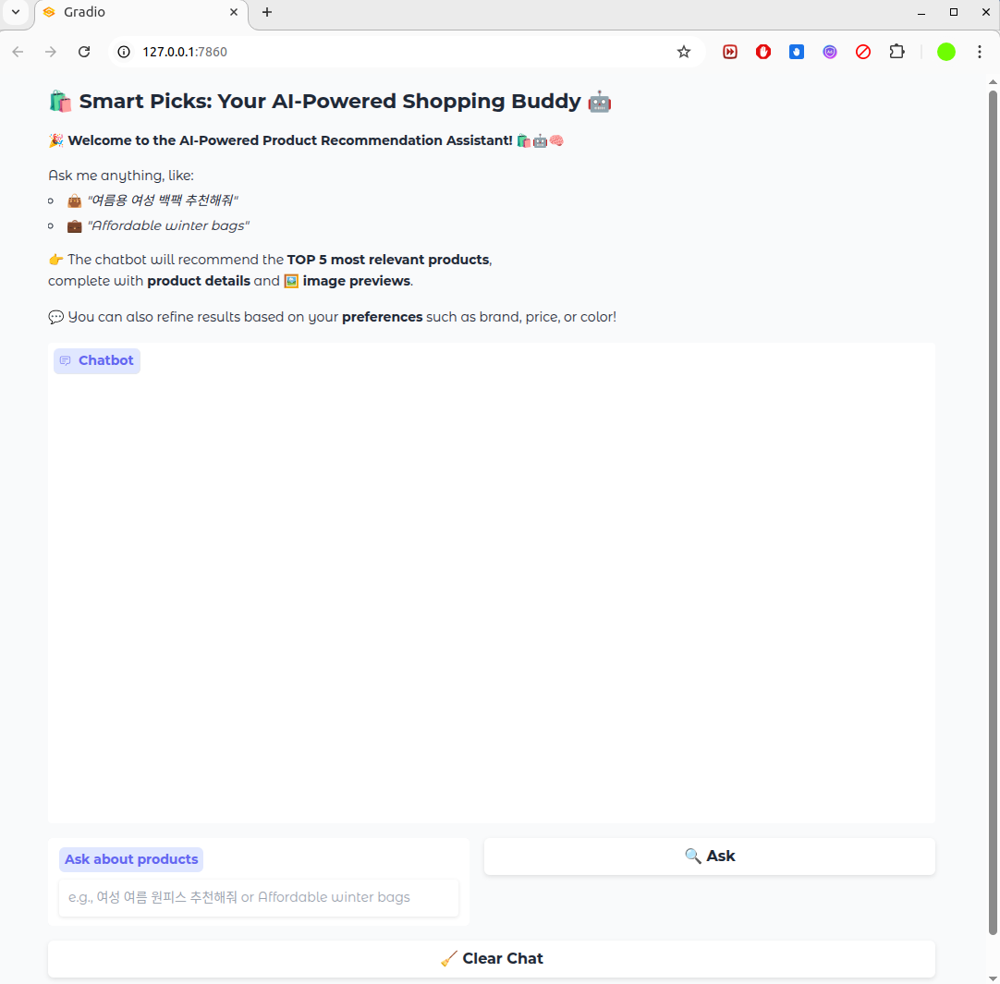
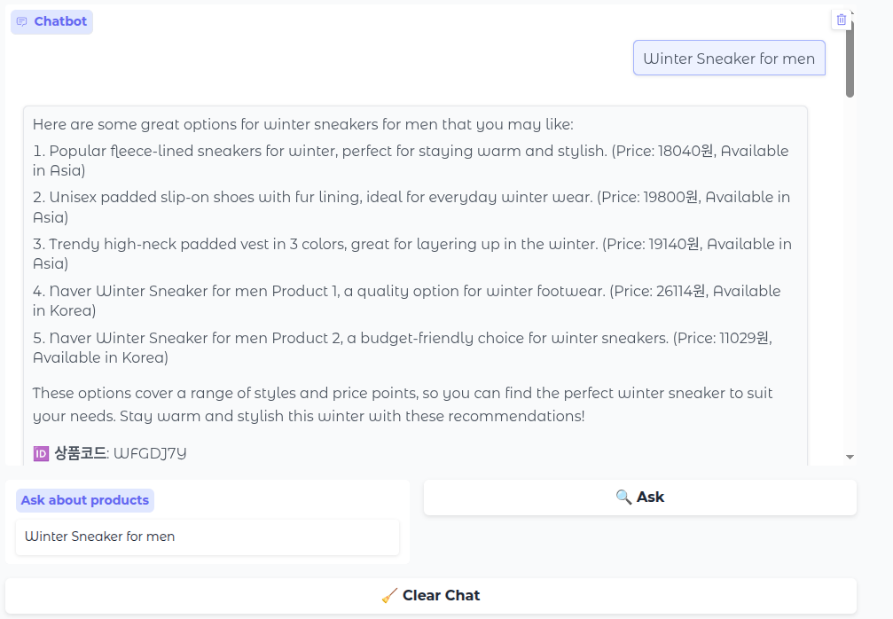
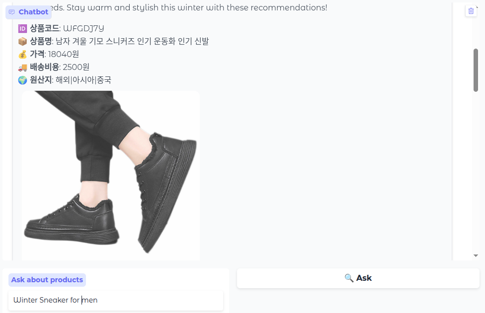
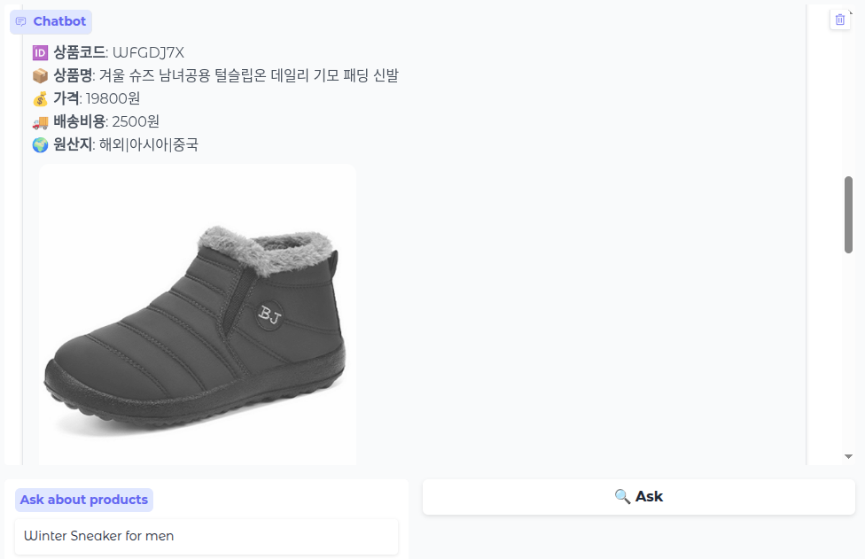
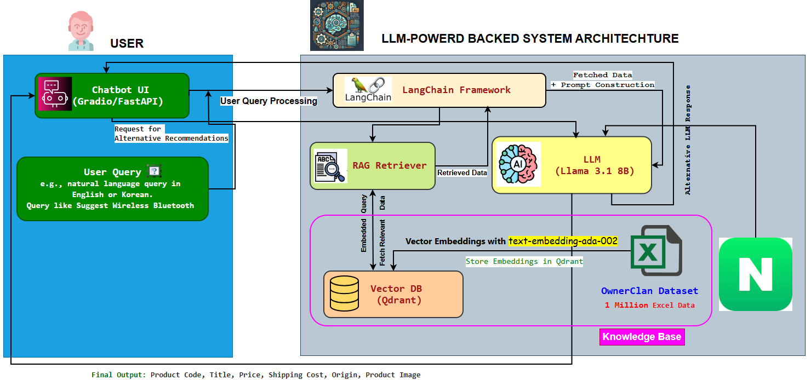

# Smart Picks: On-Premise AI Product Recommendation System

**An LLM- and RAG-based product search and recommendation assistant for independent online stores.**

Developed in collaboration with **Narosu Co. Ltd.**, this project explores how an online store can provide natural-language product discovery without relying only on exact keyword matching. A user describes what they need in a conversational query, and the system retrieves relevant products from the OwnerClan catalogue and Naver, then presents a ranked set of recommendations with product information and images.

> **Project status and deployment note:** The application is designed for on-premise deployment and operational control. The documented stack uses OpenAI `text-embedding-ada-002` for embeddings. When called through the hosted OpenAI API, that component is external to the local deployment. A fully offline or data-resident deployment therefore requires a locally hosted or privately approved embedding service.

## Contents

- [Project motivation](#project-motivation)
- [Objectives](#objectives)
- [What makes the system different](#what-makes-the-system-different)
- [Key features](#key-features)
- [System workflow](#system-workflow)
- [Technology stack](#technology-stack)
- [Data sources](#data-sources)
- [Recommendation output](#recommendation-output)
- [Evaluation approach](#evaluation-approach)
- [Screenshots and demo examples](#screenshots-and-demo-examples)
- [Setup and execution](#setup-and-execution)
- [Configuration and privacy](#configuration-and-privacy)
- [Limitations and future improvements](#limitations-and-future-improvements)

## Project motivation

Large e-commerce marketplaces can provide sophisticated recommendation services, but independent online store operators may not have the resources to build and maintain similar systems. Conventional product search can also miss relevant items when a shopper describes a need using different words from those used in a product title or description.

This project addresses that gap through semantic retrieval and conversational recommendations. Instead of depending only on exact keyword overlap, it represents product information and user queries as embeddings, searches for semantically related products, and uses an LLM to produce a more natural recommendation response.

## Objectives

1. Develop an AI-based search and recommendation system that interprets natural-language user queries.
2. Recommend the **Top 5 relevant products** using semantic similarity and retrieved product information.
3. Combine NLP, vector search, and Retrieval-Augmented Generation (RAG) in one recommendation workflow.
4. Support an interactive chatbot experience, including follow-up requests and alternative recommendations.
5. Provide a deployment approach that gives independent store operators greater control over their recommendation application and data.

## What makes the system different

| Conventional product search | Smart Picks approach |
|---|---|
| Often relies heavily on exact keywords or filters. | Uses text embeddings and semantic vector search to match the meaning of a query. |
| Usually returns a product list with limited conversational context. | Uses an LLM-backed chatbot to explain and refine recommendations. |
| May search within one catalogue. | Combines OwnerClan catalogue retrieval with Naver product lookup. |
| Requires users to reformulate searches manually. | Supports follow-up prompts, preference refinement, and alternative recommendations. |
| Product details may be scattered across result pages. | Presents key product attributes and image previews in a unified response. |

The main contribution is the integration of **semantic retrieval, RAG-based context, LLM reasoning, and multi-source product results** in a chatbot workflow intended for independent online stores.

## Key features

### 1. Natural-language product discovery

- Accepts descriptive product requests instead of requiring users to enter exact product titles.
- The project materials demonstrate Korean and English queries. The project description also specifies multilingual input, including Japanese; actual language coverage depends on the translation and query-processing components enabled in the deployed version.
- Product catalogue records are primarily in Korean. As a result, some product details may remain in Korean when the query is written in English or another language unless translation is enabled.

### 2. Top 5 recommendations from multiple sources

The current project description specifies a five-item result set:

- **3 products from OwnerClan**
- **2 products from Naver** (through the configured API or crawling route)

The system combines the results and presents product information in the chatbot. The source mix can be adjusted as the recommendation policy evolves.

### 3. Semantic search with Qdrant

- Converts query and catalogue text into vector representations using `text-embedding-ada-002`.
- Stores and searches product vectors in Qdrant.
- Uses similarity search to retrieve products that are semantically related to the user request.
- Supports catalogue metadata and attribute-based filtering as configured in the retrieval layer.

### 4. Retrieval-Augmented Generation (RAG)

LangChain coordinates retrieval and LLM interaction. Relevant product records are fetched from the vector store and supplied as context to the language model. This grounds the generated recommendation response in retrieved catalogue information rather than relying only on the LLM's general knowledge.

### 5. Conversational refinement and alternative recommendations

- Supports follow-up questions and refinement prompts.
- Allows users to narrow recommendations using preferences such as brand, colour, or product category.
- Can generate alternative recommendations when the first set does not meet the user's needs.
- The workflow materials describe combining recent chat context with the current query.

### 6. Product information and image previews

The recommendation response can include:

- Product code
- Product title
- Price
- Shipping cost
- Country or place of origin
- Product image

### 7. Additional application features

The later project presentation lists the following extended features:

- Login and registration
- Multiple-user management
- Chat history
- Voice input
- A dedicated Naver product-search button
- An evaluation dashboard
- Flexible model and embedding-model configuration
- Modifiable product attribute fields, such as title, code, and origin

The availability of each item may depend on the code version and deployment configuration.

## System workflow

The following diagram summarises the recommendation flow described in the project materials and the current project description.



1. A user submits a natural-language product query through the Gradio interface.
2. Gradio and FastAPI handle the user interaction and backend request.
3. LangChain coordinates query processing, conversation context, retrieval, and LLM calls.
4. The OwnerClan branch generates or uses embeddings and retrieves relevant catalogue items from Qdrant. The Naver branch retrieves relevant products through the configured Naver integration.
5. The recommendation layer combines the current result mix of three OwnerClan products and two Naver products.
6. The retrieved products are passed as context to LLaMA 3.1 8B through the RAG workflow. The LLM prepares the conversational recommendation and can support refinement or alternatives.
7. Gradio displays the response with product attributes and image previews.

## Technology stack

| Component | Technology | Role in the project |
|---|---|---|
| Large Language Model | **LLaMA 3.1 8B** (instant inference configuration) | Generates conversational responses and recommendation reasoning using retrieved product context. |
| LLM orchestration | **LangChain** | Connects the LLM, retriever, prompt construction, and conversation workflow. |
| Embedding model | **OpenAI `text-embedding-ada-002`** | Converts product text and user queries into vector representations. |
| Vector database | **Qdrant** | Stores product embeddings and supports similarity-based retrieval and metadata filtering. |
| Retrieval method | **RAG** | Supplies relevant catalogue records to the LLM as supporting context. |
| User interface | **Gradio** | Provides the interactive chatbot and displays recommendation results and images. |
| Backend/API | **FastAPI + Gradio** | Supports the application interface and backend API architecture. |
| External product source | **Naver API or configured crawling route** | Supplies additional product candidates. |

## Data sources

### OwnerClan product catalogue

The OwnerClan catalogue is the primary product source for semantic retrieval. The project description identifies an initial batch of approximately **7,000 products** and a larger catalogue expansion of up to **4 million items**. Different project-stage materials also refer to an intermediate catalogue size. Therefore, the exact number of indexed products should be reported according to the dataset snapshot used by the running application.

Product records contain descriptive text and attributes used for retrieval and display. The indexed fields can be extended or modified to match the store's catalogue schema.

### Naver products

Naver is used as an additional product source. The integration can retrieve candidates through the configured API or crawling method, after which relevant products are included in the final recommendation set.

## Recommendation output

The chatbot is designed to show a concise natural-language response and product cards. A product result may contain the following fields:

| Field | Description |
|---|---|
| Product code | Catalogue identifier or product code |
| Product title | Name of the recommended item |
| Price | Listed product price |
| Shipping cost | Shipping fee, when available |
| Origin | Product origin information, when available |
| Image | Product image or preview |

## Evaluation approach

The project presentation identifies the following metrics for evaluating ranked product recommendations:

| Metric | What it measures |
|---|---|
| **Precision@K** | The proportion of the top-K recommendations that are relevant. |
| **Recall@K** | The proportion of all relevant products retrieved within the top K. |
| **NDCG@K** | Ranking quality, giving greater weight to relevant products appearing nearer the top. |
| **MRR@K** | How early the first relevant result appears in the ranked list. |
| **MAP** | Mean Average Precision across evaluation queries. |

These metrics form the evaluation plan. Do not interpret the list as a set of measured results; numerical scores should be added only after running and documenting a defined evaluation experiment.

The later project presentation also sets a **response-time target of 5 seconds or less**. Actual latency can vary with the model-serving provider, embedding calls, network conditions, Qdrant configuration, and catalogue size.

## Screenshots and demo examples

The figures below are screenshots extracted from the project presentation materials.

### Chatbot interface

The Gradio interface introduces Smart Picks, provides example prompts, and accepts natural-language product requests.



### Korean query example: women's summer dress

The chatbot receives a Korean-language request and returns a conversational recommendation with product details.


The corresponding product detail view includes the product code, Korean product title, price, shipping cost, origin, and image preview.


### English query example: men's winter sneakers

The English query demonstrates product discovery for a winter footwear request. The response includes a mix of OwnerClan and Naver recommendations.



Examples of the returned product cards are shown below.





### System architecture

The project architecture connects the Gradio/FastAPI interface, LangChain, the RAG retriever, LLaMA 3.1 8B, Qdrant, the embedding model, and the OwnerClan and Naver product sources.



## Setup and execution

The exact startup command and configuration variable names depend on the entry point and environment settings in the repository. The following is a general setup sequence; update the entry-point filename if your code uses a different one.

### 1. Clone the repository

```bash
git clone <YOUR_REPOSITORY_URL>
cd <YOUR_REPOSITORY_FOLDER>
```

### 2. Create and activate a virtual environment

```bash
python -m venv .venv
```

Windows PowerShell:

```powershell
.venv\Scripts\Activate.ps1
```

macOS / Linux:

```bash
source .venv/bin/activate
```

### 3. Install the project dependencies

If the repository includes a `requirements.txt` file, install the listed packages:

```bash
pip install -r requirements.txt
```

### 4. Configure the required services

Before launching the application, configure:

- Access to the LLaMA 3.1 8B inference service used by the code.
- OpenAI credentials for `text-embedding-ada-002`, if the hosted embedding API is used.
- The Qdrant URL, collection, and authentication details, if applicable.
- Naver API credentials or the configured product retrieval route.
- The OwnerClan product data and its vector index.

Use the exact environment-variable names expected by your source code. Keep secrets in a local `.env` file or secure environment configuration, and do not commit API keys to GitHub.

### 5. Start the application

If the main application file is named `app.py`, the command may be:

```bash
python app.py
```

Otherwise, run the entry point specified by your project. Open the local URL printed by Gradio or FastAPI in the terminal.

## Configuration and privacy

- **On-premise deployment:** The application is intended to give store operators control over their deployment and recommendation workflow.
- **Embedding service:** The listed OpenAI embedding model is an API service. For strict offline operation or data-residency requirements, replace it with a suitable locally hosted embedding model or an approved private deployment.
- **LLM serving:** Confirm whether LLaMA 3.1 8B is served locally or through an external inference provider in the target deployment. The use of an open-weight model does not by itself guarantee that inference is local.
- **Credentials and catalogue data:** Do not commit API keys, customer data, private catalogue exports, or other restricted files to a public repository.

## Limitations and future improvements

- Improve the consistency of product descriptions across Korean, English, and Japanese queries.
- Add or validate translation of product titles and attributes for users who do not read Korean.
- Evaluate retrieval and ranking quality on a labelled query-product test set using Precision@K, Recall@K, NDCG@K, MRR@K, and MAP.
- Benchmark latency under a documented hardware, model-serving, and dataset configuration.
- Compare alternative embedding models and local inference options for privacy, cost, and retrieval quality.
- Improve hybrid retrieval and reranking across OwnerClan and Naver results.

## Acknowledgement

This project was developed in collaboration with **Narosu Co. Ltd.** as an applied AI product recommendation project.

---

*Smart Picks: Your AI-Powered Shopping Buddy — natural-language product discovery using LLMs, RAG, and semantic vector search.*
